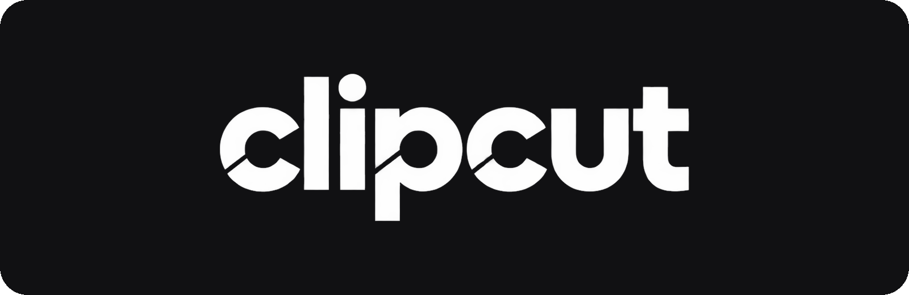

<p align="center">
  
</p>

<h3 align="center">A free, open-source video editor for Windows and macOS.</h3>

<p align="center">
  <a href="https://github.com/Realestkai/ClipCut/releases/latest"></a>
  <a href="https://github.com/Realestkai/ClipCut/releases"></a>
  <a href="LICENSE"></a>
</p>

## Download

**[realestkai.github.io/ClipCut](https://realestkai.github.io/ClipCut/)** has the download buttons, the docs and what is new in each version. Or **[get the latest release](https://github.com/Realestkai/ClipCut/releases/latest)** and pick the file for your computer:

| Your computer | File to download |
|---|---|
| **Windows** (64-bit) | `ClipCut-<version>-windows-x86_64-setup.exe` |
| **Mac, Apple silicon** (M1 and newer) | `ClipCut-<version>-macos-arm64.dmg` |
| **Mac, Intel** | `ClipCut-<version>-macos-x86_64.dmg` |

The builds are not code-signed yet, so the first launch needs one extra step:

- **Windows:** if SmartScreen stops the installer, press **More info** › **Run anyway**.
- **macOS:** drag ClipCut into Applications, then run this once in Terminal:
  `xattr -dr com.apple.quarantine /Applications/ClipCut.app`

### Updates

ClipCut updates itself. Open **Settings › Version** and press **Check for updates**: it lists the releases on this page, downloads the one you pick, checks it against its checksum and installs it over the copy you are running.

## About

ClipCut covers what most edits need: auto-captions, text-to-speech, background removal, keyframe animation, effects and titles, multi-track cutting, 4K export. No watermark, no account, no subscription, no upload.

Everything runs on your machine. Install it, drop in footage, cut. The AI models for captions, voices and cutout download once from Settings and work offline after that. Your footage never leaves your disk.

## Highlights

- 🚫 **No watermarks. No account. No paywall.**
- 🔒 **100% local.** Nothing uploads. Works offline.
- 💬 **Auto-captions.** Made on your machine. Pick a model size, get styled captions on the timeline.
- 🗣️ **Text-to-speech and voice cloning.**
- 🧍 **Background removal.** People, objects, or paint the mask yourself.
- 🎞️ **Keyframes.** Position, scale, rotation, opacity, volume, effect parameters. Curve editor built in.
- ✨ **100 effects, filters and transitions.** Live in the preview.
- ✂️ **Cut fast.** Split, trim, ripple, merge, freeze frame, speed. Magnetic timeline if you want it.
- 🎚️ **Multi-track, multi-timeline.** Overlays, picture-in-picture, blend modes, crop, flips.
- 📝 **Titles.** Fonts, stroke, shadow, background plate. Presets to start from.
- 🎙️ **One-switch voice cleanup.** Denoise, enhance voice, level the loudness.
- 📤 **Export.** H.264, HEVC, AV1. Up to 4K 60, 10-bit colour.
- 🤖 **Scriptable.** An MCP server built in, so AI agents can edit with it ([set up](docs/MCP.md)), and a JSON-RPC API for scripts.
- 🌍 **26 languages.**

## Build from source

You need Rust 1.93 or newer (see `rust-version` in `src/Cargo.toml`), the FFmpeg 7+ development libraries, cmake and a C++ compiler.

- **macOS:** `brew install ffmpeg`
- **Windows:** from [FFmpeg's Windows downloads](https://ffmpeg.org/download.html#build-windows), take BtbN's `win64-lgpl-shared` build (the one CI uses), unpack it and point `FFMPEG_DIR` at it

Then:

```sh
cd src
cargo run -p clipcut          # the editor window
```

Other useful commands:

```sh
cargo build --profile app -p clipcut   # the shipping binary (fat LTO, stripped)
cargo test                             # run the test suite
cargo fmt --check && cargo clippy --all-targets -- -D warnings   # what CI checks
```

## Releasing a new version

1. Change `version` near the top of `src/Cargo.toml` (for example `0.2.11` to `0.2.12`).
2. Commit and push to `main`.

GitHub Actions builds the Windows installer and both Mac disk images, launches each one to check it starts, and publishes them as a release tagged `v<version>`. Every installed copy of ClipCut offers the new version from then on. A push that does not change the version releases nothing.

## Licence

ClipCut is free software under [AGPL-3.0-or-later](LICENSE): you may use, study, change and share it, and anyone you give it to gets the same rights and the complete source, which is this repository. See [LICENSING.md](LICENSING.md) and [THIRD_PARTY_NOTICES.md](THIRD_PARTY_NOTICES.md).
